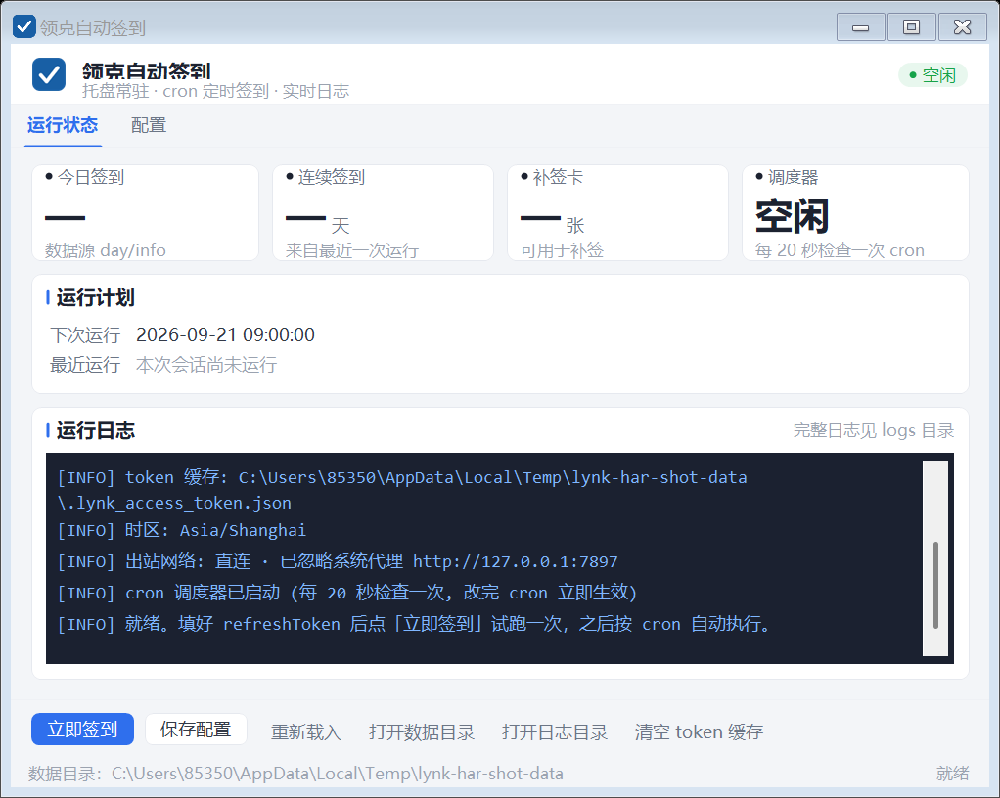
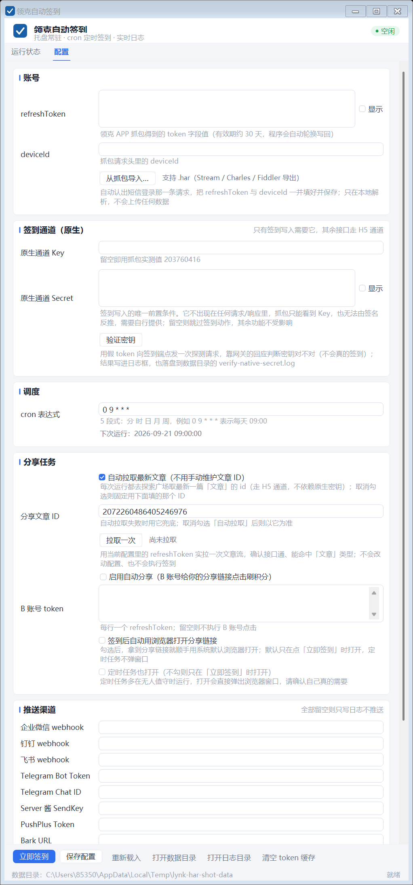

# 领克 APP 自动签到 · Windows 桌面版（.NET 10）

支持下原作者：https://github.com/sy5t4w-del/lynk_auto_sign

一个 **Windows 桌面小程序**：托盘常驻、cron 定时调度、可视化配置、实时运行日志。
点击「立即运行」或在设定的时间自动帮你完成领克 APP 的每日签到，并把结果推到企业微信 / 钉钉 / 飞书等渠道。

- 技术栈：**.NET 10 + WinForms**（无 Web 服务、无第三方 NuGet 依赖，只用 BCL）
- 界面全部代码手绘，无 `.Designer.cs` / `.resx`
- 数据落在 `%APPDATA%\LynkSign`，程序目录可以只读，卸载不会带走配置

> **本仓库只有桌面版一个可执行项目。** 原先的 Web 配置中心版（`src/LynkSign`，Kestrel + `wwwroot/config.html`）
> 已连同 `Dockerfile` / `docker-compose.yml` / 根目录 `config.html` / `dist` 一起删除。
>
> 原 **Python 实现**已移到 `reference/python/`（`ql_lynk.py` / `config_server.py` /
> `README.python.md` / `Dockerfile.python` / `docker-compose.python.yml`），仅作迁移前后的逐行对照，
> 不参与 .NET 版构建，也不在解决方案里。第三方参考仓库（如 `LynkCoHelper-main`）同样收在 `reference/` 下。

## ✨ 功能特性

- 🖥️ **桌面界面**：「运行状态 / 配置」两个页签，改完点保存即生效，无需编辑 JSON
- 📌 **托盘常驻**：关掉窗口不退出，静默守在右下角，签到不会因为"窗口关了"而停
- ⏰ **cron 定时调度**：标准 5 段表达式，保存后 **20 秒内**自动生效，不用重启
- 🌅 **每天 00:01 自动刷新状态**：跨过零点后「今天签没签」已经归零、连续天数按昨天的结果落定，
  这时自动把最新状态拉一遍刷到界面上（**只读**：不签到、不推送；程序启动时若已过该时间也会补刷一次）
- ✅ **签到后复核**：签到成功后立刻重查一次账户与状态，所以界面卡片和推送里的**积分 / 成长值 /
  连续天数都是签到之后**的最新值，不会拿签到前的快照去发推送
- ▶️ **手动触发**：界面上的「立即运行」，或命令行走一次 `--run-once` 就退出
- 📄 **运行日志**：每次运行一条记录，成功/失败一目了然，保留 35 天，运行中也能实时看输出
- 🔄 **Token 自动续期**：refreshToken 轮换后自动写回 `config.json`，不用手动更新
- 📥 **抓包一键导入**：选一个抓包文件（`.har`），自动认出短信登录那一条，把 `refreshToken`
  与 `deviceId` **成对**填好并保存 —— 不用再在几十条请求里翻 JSON、抄那两串长得像的 ID
- 📰 **分享文章 ID 自动拉取**：默认每次去探索广场取**最新一篇**文章的 id，避免写死的 id 被下架后
  「签到成功但分享静默不加分」（见下方 [配置项说明](#分享文章-id-从哪来)）
- 🔗 **签到后自动开浏览器**：把分享链接直接打开，可选 `off` / `manual` / `always`
- 📢 **多渠道推送**：企业微信 / 钉钉 / 飞书 / Telegram / Server酱 / PushPlus / Bark
- 🤝 **自动分享刷积分**：可选，B 账号自动帮主账号刷分享能量体
- 🧩 **零第三方依赖**：只用 .NET BCL，构建快、供应链干净
- 📦 **一键安装包**：Inno Setup 打的 `setup.exe`，**免管理员、目标机器免装 .NET 运行时**

## 🖼️ 界面预览

运行状态（含实时日志）



配置页



> 上图为真实截图（`--screenshot-live` 抓屏），数据均为演示用虚构内容。

## 📁 目录结构

```
lynk_sign_docker-main/
├── LynkSign.slnx                        # 解决方案（只有 WinForms 一个项目）
├── LynkSign.WinForms/                   # ★ 唯一的可执行项目（WinExe / net10.0-windows）
│   ├── LynkSign.WinForms.csproj         #   程序集名 LynkSignGUI，版本信息也在这里
│   ├── Program.cs                       #   入口：命令行开关 + 单实例锁 + 起窗
│   ├── Directory.Build.targets          #   IDE 生成空 .resx 的兜底排除（防 MSB3577）
│   ├── app.ico                          #   程序图标（7 档，由 assets/icon 的矢量源生成）
│   ├── App/                             #   外壳：容器 / 单实例 / 崩溃报告 / 日志转发 / 开机自启
│   │   ├── AppHost.cs                   #     服务容器（与窗体共享同一套对象图）
│   │   ├── SingleInstance.cs            #     重复启动时把已有窗口唤到前台
│   │   ├── CrashReport.cs               #     兜底异常弹窗（含可直接复制的堆栈）
│   │   ├── UiLogWriter.cs               #     Console.Out 转发进窗体日志框
│   │   └── WinAutostart.cs              #     HKCU Run 写/删（不需要管理员）
│   ├── Forms/
│   │   ├── MainForm.cs                  #   界面搭建（全部手写）
│   │   ├── MainForm.Logic.cs            #   事件与状态刷新
│   │   └── MainForm.Diag.cs             #   自检项（--selftest 用）
│   ├── Ui/                              #   自绘控件与主题
│   │   ├── Theme.cs / CardPanel.cs / MetricCard.cs     #   配色、卡片、指标块
│   │   ├── FlatButton.cs / FlatCheckBox.cs / InputField.cs
│   │   ├── StatusPill.cs / TabStrip.cs
│   ├── Shared/                          # ★ 全部业务源码（Web 版删除后整体搬到这里）
│   │   ├── Configuration/
│   │   │   ├── AppConfig.cs             #   config.json 强类型模型 + 宽容 JSON 转换器
│   │   │   └── ConfigStore.cs           #   原子读写 config.json
│   │   ├── Infrastructure/
│   │   │   ├── AppPaths.cs              #   数据目录 / 日志目录 / 缓存路径解析
│   │   │   ├── HttpClientSetup.cs       #   显式构造 handler（不吃系统代理）
│   │   │   ├── BrowserLauncher.cs       #   用默认浏览器打开分享链接
│   │   │   ├── ShareUrlOpenMode.cs      #   open_share_url 三态的解析与判定
│   │   │   ├── ShareContentMode.cs      #   share_content_mode 两态的解析与判定
│   │   │   ├── TimeUtil.cs / JsonExt.cs
│   │   ├── Logging/IJobLogger.cs        #   日志抽象（含 ConsoleJobLogger）
│   │   ├── Lynk/
│   │   │   ├── LynkConstants.cs         #   域名 / 端点 / 签名常量
│   │   │   ├── LynkSignature.cs         #   X-Ca-* HMAC-SHA256 签名
│   │   │   ├── LynkApiClient.cs         #   接口调用（签到 / 能量 / 成长 / 任务 / 分享 / 文章流）
│   │   │   ├── ShareArticleFinder.cs    #   ★ 从内容流里挑出「第一篇文章」的宽松解析
│   │   │   ├── HarCredentialExtractor.cs#   ★ 从抓包文件(HAR)里认出登录凭据（附离线回归）
│   │   │   ├── SignProfile.cs           #   两条通道（网页 / 原生）的密钥与请求头差异
│   │   │   ├── NativeChannelProbe.cs    #   原生通道密钥探测（--verify-native-secret）
│   │   │   ├── SignatureSelfCheck.cs    #   签名串拼接的离线回归
│   │   │   ├── SignStatusReader.cs      #   「今天签没签」的宽松字段解析
│   │   │   ├── ApiResponse.cs / TokenCache.cs / TokenManager.cs
│   │   ├── Push/PushService.cs          #   7 个推送渠道
│   │   ├── Scheduling/
│   │   │   ├── CronExpression.cs        #   5 段 cron 解析（Vixie 语义）
│   │   │   └── SignScheduler.cs         #   每 20 秒检查一次是否该跑
│   │   └── Services/
│   │       ├── SignJob.cs               #   ★ 签到主流程（5 步）
│   │       ├── SignJobRunner.cs         #   串行执行 + 日志落盘 + 状态维护
│   │       ├── TokenRotationWriteBack.cs#   refreshToken 轮换后写回（三处共用）
│   │       ├── RunLogStore.cs           #   日志仓库（35 天留存 / 列表 / 退出码解析）
│   │       ├── JobState.cs / QlEnvUpdater.cs
│   │       └── CliOptions.cs            #   命令行参数 + 配置优先级解析
│   ├── packaging/                       # ★ 打包
│   │   ├── build-installer.ps1 / .bat   #   发布 + 凭据闸门 + 压成 setup.exe（对外发版用）
│   │   ├── pack-quick.ps1 / .bat        #   日常迭代快打（增量判断 + 发布目录占用检测）
│   │   ├── installer.iss                #   Inno Setup 脚本
│   │   └── ChineseSimplified.isl        #   中文向导语言文件
│   └── dist/                            # 发布与安装包输出（不入库）
├── reference/                           # ☆ 参考与留档（不参与构建，不在解决方案里）
│   ├── python/                          #   原 Python 实现，仅作迁移前后的逐行对照
│   │   ├── ql_lynk.py                   #     签到核心脚本
│   │   ├── config_server.py             #     Web 配置页 + cron 调度 + 日志服务
│   │   ├── Dockerfile.python / docker-compose.python.yml
│   │   ├── requirements.txt             #     Python 依赖（仅 requests）
│   │   ├── README.python.md             #     原 Python 版说明
│   │   └── server.log                   #     旧 Web 服务的运行日志（留档）
│   └── LynkCoHelper-main/               #   第三方参考仓库（不入库）
├── config.example.json                  # 配置模板
├── config.json                          # 开发用配置（含真实 token，已被 .gitignore 忽略）
├── lynkco-secret.json                   # 原生通道密钥提取结果（明文，勿外传）
├── docs/                                # 界面截图
├── assets/icon/                         # 品牌图标源（矢量 + 历史留档）
│   ├── h-icon-night.svg                 #   ★ 图标矢量源（深蓝底 + 青蓝渐变 H）
│   ├── app-icon-preview.png             #   从矢量渲的 256 预览图
│   ├── app-icon-sizes.png               #   16→256 各档位放大对比（换图标后验收用）
│   └── legacy/app-check-mark.ico        #   最初那版「蓝底白对勾」图标（留档）
├── tools/                               # 开发辅助脚本（图标生成 / 接口诊断，不入库）
│   ├── build-app-icon.cjs               #   ★ SVG → 多尺寸 app.ico（逐档矢量渲染，非缩放）
│   ├── make-icon.py                     #   旧版对勾图标生成器（历史脚本，输出已改到 legacy/）
│   ├── preview-icon.py / verify-icon-embedded.py    # 抠某档预览 / 验证已嵌进 exe
│   ├── fix-ps1-encoding.py              #   给 .ps1 补 UTF-8 BOM（防中文乱码）
│   └── diagnose-lynk-api.py             #   用假 token 直接打网关的对照诊断
└── logs/                                # 从源码运行时的日志（发行版写在 %APPDATA%\LynkSign）
```

> `config.json`（含真实 token）已在 `.gitignore` 中忽略，不会被提交。

## 🚀 快速开始

### 方式一：装别人给你的安装包（推荐）

拿到 `LynkSignGUI-Setup-1.0.0.exe` 后双击：

- 装到 `%LOCALAPPDATA%\Programs\LynkSignGUI`（每用户，**不弹 UAC、不需要管理员**）
- 数据写在 `%APPDATA%\LynkSign`，**卸载重装都不会丢**
- 可勾选桌面图标与**开机自启**
- 目标机器**不需要预装 .NET 运行时**（自包含发布）

装完在开始菜单找到「领克自动签到」，把 `refresh_token` / `device_id` 填进「配置」页保存即可。

### 方式二：直接跑发布目录（免安装）

```
LynkSign.WinForms\dist\LynkSignGUI-win-x64\
└── LynkSignGUI.exe        ← 双击即可
```

双击后主窗口出现（右下角同时有托盘图标）。想静默常驻、不开窗口：

```powershell
LynkSignGUI.exe --minimized
```

### 方式三：从源码构建

需要 **.NET SDK 10.0+**（验证版本：`10.0.400`）：

```powershell
dotnet build LynkSign.WinForms\LynkSign.WinForms.csproj
dotnet run   --project LynkSign.WinForms
```

打安装包（需要装了 [Inno Setup 6](https://jrsoftware.org/isdl.php)）：

```powershell
powershell -ExecutionPolicy Bypass -File LynkSign.WinForms\packaging\build-installer.ps1
```

脚本分三步走，产物是 `LynkSign.WinForms\dist\LynkSignGUI-Setup-<版本>.exe`：

| 步骤 | 做什么 |
|------|--------|
| 1 | `dotnet publish` 自包含发布到 `dist\LynkSignGUI-<rid>`（默认 `win-x64`） |
| 2 | **凭据闸门**：确认发布产物里没有 `config.json` / `logs` / token 缓存 |
| 3 | 用 `ISCC.exe` 压成一个 `setup.exe` |

常用参数：`-Version 1.2.0` 覆盖版本号、`-RuntimeIdentifier win-arm64` 换架构、`-SkipPublish` 拿现有 `dist` 重新打包。

> ⚠️ 第 2 步的闸门不是多余的：一旦 `config.json` 混进发布目录，它里面是**明文 refreshToken**，
> 随包分发就等于泄露账号，所以**发现即中止构建**。

> 刻意**不用** `PublishSingleFile`：WinForms 的自包含单文件每次启动都要把 native 依赖解压到临时目录，
> 冷启动会多出好几秒；而安装包本来就由 Inno Setup 压成 LZMA2，「多文件目录 + 安装包压缩」
> 才是桌面应用启动最快的组合。

## 💻 命令行参数

桌面版是托盘程序，命令行开关主要给**安装包、开机自启、任务计划程序、排障**用。

### 启动与自启

| 参数 | 说明 |
|------|------|
| （无参数） | 启动主窗口 + 托盘 + cron 调度 |
| `--minimized` | 启动后不显示主窗口，直接缩到托盘（**开机自启指向的就是它**） |
| `--data-dir <目录>` | 覆盖数据目录（默认 `%APPDATA%\LynkSign`） |
| `--install-autostart` | 设置开机自启（写 `HKCU\...\CurrentVersion\Run`，不需要管理员）后退出 |
| `--uninstall-autostart` | 取消开机自启后退出 |
| `-h` / `--help` | 打印用法后退出 |

### 单跑与诊断（都不进界面）

| 参数 | 说明 | 退出码 |
|------|------|:---:|
| `--run-once` / `--once` | 跑一次签到后退出。日志照常落盘，事后能在界面「运行日志」里翻到 | 见下 |
| `--clear-cache` | 清空 accessToken 缓存后退出 | 0 |
| `--selftest` | 跑一遍链路自检（控件绑定 / 配置解析 / 签名拼接 / 文章流解析），报告写进数据目录 `selftest.log` | 0=全过 |
| `--verify-native-secret` | 用**假 token** 探测原生通道密钥对不对（不会真的签到），报告写进 `verify-native-secret.log` | 0=密钥可用 |
| `--fetch-article` | 实拉一次探索广场文章流，打印取到的最新一篇，用来验证「自动拉取文章 ID」这条链路 | 0=取到文章 |
| `--refresh-status` | 只拉一次最新签到状态（`day/info` + 连续天数 / 补签卡 + 账户信息），**不签到、不推送**。与「每天 00:01 自动刷新」是同一个任务，日志写进 `logs\run-*-status.log` | 0=拉到状态 |
| `--import-har <文件>` | 从抓包文件（`.har`）里认出短信登录那一条，把 `refreshToken` 与 `deviceId` 一起写回 `config.json`（报告写进 `import-har.log`） | 0=导入成功 |
| `--screenshot <目录>` | 把两个页签**离屏**渲染成 PNG（调外观用） | — |
| `--screenshot-live <目录>` | 真开一次窗口、抓屏存 PNG | — |

> `--run-once` 的退出码沿用签到流程自己的语义：
> `0` 成功 / `1` 未配置 refreshToken / `2` 续 token 失败 / `3` 查签到状态失败 / `4` 签到接口失败 / `99` 未捕获异常。
> 拿任务计划程序定时跑的话，直接按 `0` 判成败即可。

> 想拿诊断报告又看不到控制台时（GUI 程序不挂父控制台），直接去数据目录看那几个 `.log`：
> `selftest.log` / `verify-native-secret.log` / `fetch-article.log`。

### 签到参数（只在 `--run-once` 这条路径上生效）

界面里的值一律来自 `config.json`；下面这些参数是给命令行覆盖用的，
优先级是 **命令行参数 > 环境变量（`LYNK_*`）> `config.json` > 默认值**。

| 参数 | 说明 |
|------|------|
| `--token <v>` | 主账号 refreshToken |
| `--device-id <v>` | 设备 ID |
| `--token-b <v>` | B 账号 refreshToken 列表，逗号分隔 |
| `--content-id <v>` | 分享文章 ID（`fixed` 档用；`auto` 档拉不到时的兜底） |
| `--share-content-mode [v]` | 分享文章 ID 来源：`auto`（默认，拉广场最新一篇）/ `fixed`（固定用 `--content-id`） |
| `--ca-native-key <v>` | 原生通道 app key（默认 `203760416`） |
| `--ca-native-secret <v>` | 原生通道 app secret（签到写入必需） |
| `--auto-share` | 启用自动分享任务 |
| `--open-share-url [v]` | 签到后自动用浏览器打开分享链接：`manual`（默认，仅手动触发）/ `always` / `off` |
| `--no-open-share-url` | 本次不自动打开分享链接（覆盖 `config.json`） |
| `--no-cache` | 忽略 accessToken 缓存，强制 refresh |
| `--quiet` | 静默模式，不打印原始响应 |

### 环境变量

| 变量 | 说明 | 默认 |
|------|------|------|
| `LYNK_DATA_DIR` | 数据目录（`config.json` / `logs` 的父目录） | `%APPDATA%\LynkSign` |
| `LYNK_CONFIG_FILE` | config.json 路径 | 数据目录 `config.json` |
| `LYNK_LOGS_DIR` | 日志目录 | 数据目录 `logs` |
| `LYNK_CACHE_FILE` | accessToken 缓存路径 | 见下 |
| `TZ` | 触发时区 | `Asia/Shanghai` |
| `LYNK_TZ_OFFSET` | 拿不到时区库时的固定偏移（小时） | `8` |
| `LYNK_CA_NATIVE_KEY` / `LYNK_CA_NATIVE_SECRET` | 原生通道密钥 | `203760416` / 空 |
| `LYNK_OPEN_SHARE_URL` | 签到后自动打开分享链接：`off` / `manual` / `always` | `off` |
| `LYNK_SHARE_CONTENT_MODE` | 分享文章 ID 来源：`auto` / `fixed` | `auto` |
| `LYNK_REFRESH_TOKEN` / `LYNK_DEVICE_ID` / `LYNK_TOKEN_B` / `LYNK_SHARE_CONTENT_ID` / `LYNK_AUTO_SHARE` | 对应配置项，优先级高于 config.json | — |
| `PUSH_*` | 各推送渠道（见下表） | — |

`accessToken` 缓存文件按以下顺序挑选第一个可写位置：

```
$LYNK_CACHE_FILE
运行目录\.lynk_access_token.json → 临时目录\lynk_access_token.json → 用户主目录\.lynk_access_token.json
```

## ⚙️ 配置项说明

所有配置都在 `config.json`（也就是界面上编辑的内容），字段名与 Python 版**完全一致**，可直接沿用旧文件：

| 字段 | 说明 | 必填 |
|------|------|:---:|
| `refresh_token` | 主账号 refreshToken（28 天有效，`bearer<uuid>` 格式）。抓包后可用「从抓包导入…」一键填 | ✅ |
| `device_id` | 设备 ID（登录 URL 里的 `deviceId` 参数）。同上，导入时一起填好 | ✅ |
| `ca_native_secret` | 原生通道 app secret，**签到写入必需**（见「签到接口 403」） | ✅ |
| `cron` | 运行计划，标准 5 段 cron 表达式 | ✅ |
| `auto_share` | 是否启用自动分享刷积分（`true`/`false`） | |
| `token_b` | B 账号 refreshToken 列表（帮主账号点击分享） | |
| `share_content_id` | 分享文章 ID。`auto` 档拉不到时的**兜底**，`fixed` 档就是它本身 | |
| `share_content_mode` | 分享文章 ID 来源：`auto`（默认，自动拉广场最新一篇）/ `fixed`（固定用上面的 id） | |
| `open_share_url` | 签到后自动用浏览器打开分享链接：`off`(默认) / `manual`(仅手动触发) / `always`(手动+定时) | |
| `push.*` | 各推送渠道的 webhook / token（见下） | |

### <a id="分享文章-id-从哪来"></a>分享文章 ID 从哪来（`share_content_mode`）

分享链接里带着被分享文章的 id（`?id=…`），B 账号点开加分时后端会拿这个 id 去校验前后两步一致，
所以它**必须是一个当前有效的文章**。而文章会被下架、会过期 —— 写死一个 id 迟早会失效，
且失效那天**不会有任何报错**，只表现为「签到成功，但分享不加分」。

所以默认走 `auto`：

| 值 | 行为 |
|----|------|
| `auto`（默认） | 每次运行先拉一次探索广场内容流，取**最新一篇「文章」**的 id；拉不到则回退到 `share_content_id`；`share_content_id` 也空则用内置默认值 |
| `fixed` | 不发额外请求，直接用 `share_content_id` |

- 取值端点：`POST /app/explore/home-page/square/index2`（最多翻 3 页找第一篇文章）
- 挑文章时**会跳过视频**等其它内容类型；只有打不开的响应结构才会触发回退
- 落空时日志里会留一条 `[WARN]`，写明回退到了哪个 id —— 这一行是"为什么分享不加分"的第一线索
- 想确认这条链路当下通不通，跑一次 `LynkSignGUI.exe --fetch-article`，或点配置页上的「拉取一次」
- 认不出的值一律按 `auto` 处理：拿不准时选那个"不会悄悄坏掉"的一档

### 如何获取 token（iPhone 抓包教程）

需要两个值：

| 值 | 是什么 | 从哪来 |
|----|--------|--------|
| `refresh_token` | 长期登录凭证，`bearer<uuid>` 格式，**28 天有效**（本项目会自动续期） | 登录响应 `data.centerTokenDto.refreshToken` |
| `device_id` | 设备标识 | 登录请求 URL 里的 `deviceId` 查询参数 |

> ⚠️ 别抓错：响应里还有个 `token`，那是 **accessToken，只约 10 分钟有效**，填进去会报 `user_refresh_invalid_expired`。
>
> ⚠️ **`refreshToken` 只在「登录响应」里下发一次**，所以抓包的正确顺序是 **先开抓包 → 再退出登录 → 重新登录**。中途才开抓包是抓不到的。

#### 1. 选工具

| 工具 | 平台 | 特点 |
|------|------|------|
| **Stream** | iPhone 本机 App | 免费、不需要电脑，最省事；App Store 搜不到时换电脑方案 |
| **Charles** | Windows / macOS | 老牌，功能全（断点 / Rewrite / Map Local），试用 30 天后需付费 |
| **Reqable** | Windows / macOS / Android | 中文、免费、跨平台，上手快，推荐 Windows 用户 |

> 代理端口：Charles / Reqable 默认都是 `8888`。

#### 2. 配置代理并装 CA 证书

**电脑端**：打开抓包工具 → 开启 HTTPS 解密（Charles：`Proxy → SSL Proxying Settings`，Add 一条 Host `*lynkco*`、Port `443`）→ 记下本机局域网 IP（Charles：`Help → Local IP Address`）。

**iPhone 端**：

1. 确保 iPhone 和电脑连**同一个 WiFi**；关掉 VPN 和 **iCloud 私人中继**（会绕过代理）
2. `设置 → Wi-Fi → 点网络右侧的 ⓘ → 配置代理 → 手动`，服务器填电脑 IP，端口 `8888`，认证关
3. Safari 打开证书地址下载描述文件（Charles 是 `https://chls.pro/ssl`；其他工具界面里会有地址或二维码）
4. `设置 → 通用 → VPN与设备管理` → 点该描述文件 → **安装**
5. `设置 → 通用 → 关于本机 → 证书信任设置` → 打开该证书的 **「完全信任」**
   👆 **第 4、5 步缺一不可**，只装不信任的话，所有 HTTPS 都会是 TLS 握手失败

> 抓完记得回到第 2 步把代理改回 **「关闭」**，否则 iPhone 会断网。

#### 3. 按顺序操作

1. 抓包工具开始录制
2. 打开领克 APP → 我的 → **退出登录**
3. 重新登录（手机号 + 验证码）
4. 在抓包记录里过滤 `lynkco`，找到 `POST /auth/login/mobileCodeLogin`，确认它的响应体是明文 JSON
5. 停止录制，把这段记录**导出成 HAR**（Charles：`File → Export Session…` → 选 `.har`；其他工具找「导出 / Export」里的 HAR）

#### 4. 导入这两个值（一键完成）

导出的 HAR 里本来就把两个值都带齐了，直接让程序去读：

| 方式 | 操作 |
|------|------|
| **界面（推荐）** | 配置页 →「账号」卡片 → 点 **「从抓包导入…」** → 选中刚导出的 `.har` |
| 命令行 | `LynkSignGUI.exe --import-har <抓包文件.har>` |

它会做四件事：

1. 在抓包里认出 `POST …/auth/login/mobileCodeLogin` 那一条（有多条登录记录时取**最后一条**）；
2. `refresh_token` ← 响应 `data.centerTokenDto.refreshToken`（**连 `bearer` 前缀整串**）；
3. `device_id` ← 同一个请求 URL 里 `deviceId=` 的值 —— 注意 query 里还有个相邻的
   `hardwareDeviceId`，两者只是长得像、用途不同，取错了签到必然失败；
4. 把这两个值**一起**写回 `config.json`（不动其它字段），并在按钮旁显示账号手机号，
   方便核对导进来的是不是自己的号。

解析全程在本机完成，**不会上传任何数据**；日志里只露 token 尾巴（`...b87e6c26dcb9`）。

登录成功的响应结构长这样，也就是它的取值依据：

```json
{
  "code": "success",
  "data": {
    "centerTokenDto": {
      "token": "bearer....",
      "refreshToken": "bearerXXXX-XXXX-XXXX-XXXX-XXXXXXXXXXXX",
      "expireAt": 1783000000000,
      "refreshExpireAt": 1786000000000
    }
  }
}
```

抓到的要是别的形态（比如只有一段响应 JSON，没有完整 HAR），也可以手工填：

- `refresh_token` ← `centerTokenDto.refreshToken`（**整串复制，含开头的 `bearer`**）
- `device_id` ← 同一个请求 URL 里 `deviceId=` 后面的值（请求头 `gl_dev_id` 里也有）

#### 5. 抓不到怎么办

| 现象 | 原因 | 处理 |
|------|------|------|
| 完全看不到 `lynkco` 的请求 | 没走代理 | 检查手动代理 IP/端口、是否同网段、关掉 VPN 与 iCloud 私人中继 |
| 请求在，但报 TLS handshake failed / 无响应体 | 证书只装了没信任 | 回到第 2 步检查「完全信任」开关 |
| Safari 能抓到，APP 抓不到 | **SSL Pinning（证书绑定）** | 见下方 |
| 只看到加密块、没有明文 | APP 走了 QUIC / HTTP3 | 抓包工具里禁用 QUIC，或强制降级 HTTP/1.1 |
| 抓到的 token 一填就报 `user_refresh_invalid_expired` | 抓成了 accessToken，或 token 已被轮换 | 重新按「先开抓包 → 再登录」抓一次 |

**SSL Pinning 的应对**（成本从低到高）：

1. 换工具再试——不同工具/版本对 pinning 的容忍度不同
2. 换一台 **Android** 手机抓（绕过手段更多，如 Frida / objection）
3. 越狱 iPhone + SSL Kill Switch 3
4. 降级安装旧版本 APP（老版本通常没加 pinning）

#### 6. 安全提醒

`refreshToken` 等同于**免密登录凭证**，泄露 = 账号被接管：

- 不要贴到群里、issue、截图里；本项目也不会向你索取 token
- **导出给你的抓包文件 `xxx.har` 本身就是明文凭据**：导入完成后把它删掉（导入时日志里也会提醒一次）
- `config.json` 已在 `.gitignore` 里，别用 `git add -f` 强行提交
- 不再使用就在 APP 里「退出登录」，让服务端使该 token 失效

#### 附：用 Charles 抓（Windows → iPhone 逐步操作）

菜单路径以 Charles 5.x 为准，当前版本 5.2.1。

**① 电脑端配置**

1. 下载安装：<https://www.charlesproxy.com/download/>（安装包**自带 JDK**，不需要另装 Java）
2. `Proxy → SSL Proxying Settings…` → 勾选 **Enable SSL Proxying** → 在 Include 里 Add 一条：
   - Host `*lynkco*`、Port `443`（图省事也可 Host `*`、Port `*`，但记录会很杂）
3. `Proxy → Proxy Settings…` → 确认 Port 为 `8888`
4. 取本机 IP：`Help → Local IP Addresses`
   ⚠️ 装过 WSL / Hyper-V / VMware 的机器会列出**多个**地址，要挑真实网卡那个（通常 `192.168.x.x`），可用 `ipconfig` 核对
5. **Windows 防火墙**：Charles 首次启动会弹「允许访问」，务必勾选**专用网络**。若当时点了取消，去「Windows Defender 防火墙 → 高级设置 → 入站规则」新建一条放行 TCP `8888`
6. 顺手让电脑自己信任证书（抓电脑浏览器的 HTTPS 要用）：`Help → SSL Proxying → Install Charles Root Certificate` → 装到「**受信任的根证书颁发机构**」

**② iPhone 端配置**

1. `设置 → Wi-Fi → 点当前网络右侧的 ⓘ → 配置代理 → 手动`
   - 服务器：电脑 IP　端口：`8888`　认证：关闭
2. 关掉 **VPN** 和 **iCloud 私人中继**（`设置 → 顶部 Apple 账户 → iCloud → 私人中继`），否则流量会绕过代理
3. Safari 打开 `https://chls.pro/ssl` → 允许下载描述文件
4. `设置 → 通用 → VPN与设备管理` → 点 **Charles Proxy CA** → 安装（需输锁屏密码）
5. `设置 → 通用 → 关于本机 → 证书信任设置` → 打开 **Charles Proxy CA** 的「**完全信任**」开关
6. iPhone 首次连上时 Charles 会弹 **Allow / Deny** 对话框 → 点 **Allow**

**③ 开始抓取**

1. 工具栏点 **Start Recording**（红点）确认处于录制状态
2. 先在 iPhone Safari 随便开个网页，Charles 里能看到记录 = 链路通了
3. 领克 APP → 我的 → **退出登录** → 重新登录
4. Charles 左下角 **Filter** 填 `lynkco`，展开 `app-services.lynkco.com.cn`，找 `POST /auth/login/mobileCodeLogin`
5. 点开这个请求：`Contents → Request` 看 URL 里的 `deviceId`；`Contents → Response` 找 `centerTokenDto.refreshToken`

**④ Charles 报错对照**

| Charles 里的现象 | 原因 | 处理 |
|---|---|---|
| 完全看不到来自 iPhone 的记录 | 没走代理 / 被防火墙拦 | 核对 IP 与端口、同网段、防火墙放行 8888 |
| `Client SSL handshake failed` | iPhone 没信任证书 | 回到 ② 第 5 步开「完全信任」 |
| `SSL Proxying not enabled for this host` | 该域名没加进白名单 | 回到 ① 第 2 步加规则 |
| 记录在，Safari 有明文但 APP 没有 | **SSL Pinning** | 见上方 Pinning 排查 |
| `Received fatal alert: certificate_unknown` | 同上 | 同上 |
| iPhone 设完代理后完全无法上网 | 代理填错，或 Charles 已退出 | 把 iPhone 代理改回「关闭」 |

> **试用版限制**：Charles 未授权时**每次运行 30 分钟会自动退出**，抓包时留意时间，必要时重开。试用期 30 天。

#### 附：Stream 抓不到领克？（VPN 模式专属排查）

Stream / Thor / HTTP Catcher 这类手机端工具走的是**本机 VPN 隧道**，和 Charles 的**系统代理**是两套机制，失效原因不同，可以交叉验证。

| Stream 里的现象 | 原因 | 处理 |
|---|---|---|
| 连 `lynkco` 域名都搜不到 | **其他 VPN 在抢占隧道** —— iOS 同时只允许一个 VPN 生效 | 关掉小火箭 / QuantumultX / Loon / 公司 VPN，再开 Stream |
| 同上 | Stream 的 VPN 配置没启用 | `设置 → 通用 → VPN与设备管理` 确认其描述文件已安装，且 VPN 处于已连接状态 |
| 同上 | 抓包时机不对 | 领克 APP 登录后会复用长连接、不产生新请求；**先杀掉 APP 后台再重开并登录** |
| 有记录但内容是加密的 | CA 证书没「完全信任」 | 重做两步：装描述文件 → `设置 → 通用 → 关于本机 → 证书信任设置` 开完全信任 |
| TLS 握手失败 / SSL error | **SSL Pinning** | 用 Charles 复验；仍失败就走 Android + Frida 或装旧版 APP |
| 只有 UDP 数据块，解不开 | App 走了 **QUIC / HTTP3** | 手机端工具基本无解，改用 Charles（能处理 HTTP/2，也能看到 CONNECT 目标） |

**两条通用心法**

1. **先分清是「抓不到」还是「没有这个请求」**：在 iPhone Safari 开个普通 HTTPS 网站，如果 Stream 里能看到明文，说明工具链是通的，问题在 App 侧；连 Safari 都看不到，问题在工具链（证书 / VPN / 时机）。
2. **用 Stream 和 Charles 交叉验证**，能一步定位是「App 防抓」还是「工具没配好」：
   - Stream 有记录、Charles 没有 → App 绕过了系统代理，**走 Stream 这条路**
   - 两边都没有 → App 在做 Pinning 或用 QUIC，**手机端抓不到，换 Android**
   - 两边都有但都解不开 → 就是 Pinning

### cron 表达式

标准 5 段格式：`分 时 日 月 周`。遵循 Vixie cron 语义（**日与周同时被限定时取「或」**，周 `0` 与 `7` 都代表周日）。配置页提供了常用预设可直接选：

| 表达式 | 含义 |
|--------|------|
| `0 9 * * *` | 每天 09:00 |
| `30 8 * * *` | 每天 08:30 |
| `0 9,21 * * *` | 每天 09:00 和 21:00 |
| `0 */6 * * *` | 每 6 小时 |
| `0 8 * * 1-5` | 工作日 08:00 |

> 触发时区由 `TZ` 环境变量决定，默认 `Asia/Shanghai`；拿不到时区库时用 `LYNK_TZ_OFFSET`（默认 `8`）。
>
> ⚠️ 调度只在**程序运行期间**有效。窗口关掉没关系（托盘还在，程序还活着），
> 但**退出托盘图标**之后就彻底不跑了 —— 想让它一直在，装的时候勾上开机自启。

### 推送渠道（`push` 字段，全部可选，留空即不推送）

| 字段 | 渠道 |
|------|------|
| `wecom_webhook` | 企业微信机器人 Webhook |
| `dingtalk_webhook` | 钉钉机器人 Webhook |
| `feishu_webhook` | 飞书机器人 Webhook |
| `tg_bot_token` + `tg_chat_id` | Telegram Bot |
| `serverchan_key` | Server酱 SendKey |
| `pushplus_token` | PushPlus Token |
| `bark_url` | Bark 推送 URL |

## 📄 运行日志

- 每次运行生成一个日志文件：`%APPDATA%\LynkSign\logs\run-<时间戳>-<触发方式>.log`
- 触发方式：`cron`（定时）/ `manual`（手动，含 `--run-once`）/
  `status`（状态刷新，即每天 00:01 与 `--refresh-status`。**自动触发时不落文件**，
  只在界面日志里出现 —— 它每天/每次启动都跑，落盘只会攒出一堆内容雷同的小日志）
- 自动保留最近 **35 天**，超期文件自动清理
- 在「运行状态」页可看列表和完整内容，运行中的任务也能实时看到输出
- 日志末尾有 `EXIT CODE`，界面顶部的状态胶囊也会把最近一次的结局直接标出来

## 🛠️ 常用运维命令

```powershell
# 从源码起一个（前台，方便看输出）
dotnet run --project LynkSign.WinForms

# 跑一次就退（任务计划程序 / Jenkins 里就是这么写）
& "$env:LOCALAPPDATA\Programs\LynkSignGUI\LynkSignGUI.exe" --run-once

# 排障：自检 / 验证原生通道密钥 / 验证文章自动拉取 / 手动刷一次签到状态
& "...\LynkSignGUI.exe" --selftest
& "...\LynkSignGUI.exe" --verify-native-secret
& "...\LynkSignGUI.exe" --fetch-article
& "...\LynkSignGUI.exe" --refresh-status

# 换账号：从抓包直接导入 refreshToken + deviceId
& "...\LynkSignGUI.exe" --import-har "$env:USERPROFILE\Downloads\lynk.har"

# 清 accessToken 缓存（换账号后第一招）
& "...\LynkSignGUI.exe" --clear-cache

# 打开数据目录 / 日志目录
explorer "$env:APPDATA\LynkSign"
explorer "$env:APPDATA\LynkSign\logs"
```

重新打包并把新版本盖上：

```powershell
# 升级前先在任务管理器结束 LynkSignGUI.exe，否则文件被占用拷不进去
powershell -ExecutionPolicy Bypass -File LynkSign.WinForms\packaging\build-installer.ps1
# 然后双击新的 dist\LynkSignGUI-Setup-<版本>.exe
```

> `%APPDATA%\LynkSign` 里的 `config.json` 与 `logs` 在覆盖安装 / 卸载重装时**都原样保留**。

### 想换程序图标

`LynkSign.WinForms\app.ico` 是**生成的**，别直接拿画图去改 —— 它是从矢量源
逐档渲染出来的（16/24/32/48/64/128/256，全 32bpp DIB，不内嵌 PNG，好让
csproj / Inno Setup / 打包脚本三处都读得动）。

改图标就三步：

1. 换掉 `assets\icon\h-icon-night.svg`（或改里面的配色 / 字形）
2. 重新生成 —— 每一档都按目标尺寸**重新渲染**，不是把大图缩小，小图标边缘才干净
3. 重新打包：`app.ico` 的改动会被 `pack-quick.ps1` 的增量判断认出来，自动重发布

```powershell
# 生成 app.ico（顺带导出 256 预览图）
$env:NODE_PATH = "$env:USERPROFILE\.workbuddy\binaries\node\workspace\node_modules"
node tools\build-app-icon.cjs --preview assets\icon\app-icon-preview.png

# 确认 7 档真的都嵌进了 exe（逐档 DIB 子串匹配）
python tools\verify-icon-embedded.py
```

> 换完**要卸载重装**（或 `ie4uinit.exe -show` 刷图标缓存）才能看到新图标 ——
> Windows 会把旧图标缓存住，直接覆盖安装可能还显示老样子。
> `tools\make-icon.py` 是旧版对勾图标的历史脚本，输出已挪到 `assets\icon\legacy\`，
> 不会再覆盖在用的 `app.ico`。


## 🔒 安全提醒

- `config.json` 含**明文 token**，位置在 `%APPDATA%\LynkSign\config.json` —— 不要截图发出去、不要提交到 Git（仓库已用 `.gitignore` 忽略）
- 桌面版**不监听任何端口、不开 HTTP 服务**，不存在"配置页暴露在公网"的问题
- 打包脚本里有一道**凭据闸门**：检测到发布产物里混进 `config.json` / `logs` / token 缓存就中止构建
- `LynkConstants` 里的 `CaKey` / `CaSecret` / `AppCode` 是 **APP 通用接口常量**（非个人凭据），
  为了让程序能调通接口而保留；`ca_native_secret` 属于个人配置，不要外传
- `tools/lynkco-secret-extract/` 与 `lynkco-secret.json` 里是原生通道密钥的提取结果，同样别提交、别外传

## 🔄 Python → .NET 10 迁移对照

| 关注点 | Python 版 | .NET 10 桌面版 |
|--------|-----------|-----------|
| 运行时 | `python:3.12-slim` | **.NET 10 自包含**（目标机器免装运行时） |
| 形态 | `http.server.ThreadingHTTPServer` + 浏览器配置页 | **WinForms 桌面窗口 + 托盘常驻** |
| HTTP 客户端 | `requests`（同步阻塞） | `HttpClient` + `IHttpClientFactory`（全异步） |
| JSON | `json` 模块（`dict.get` 到处兜底） | `System.Text.Json` + `JsonExt` 宽松读取扩展 |
| 签名 | `hmac` + `hashlib` + `base64` | `HMACSHA256.HashData` + `Convert.ToBase64String` |
| 定时调度 | `threading.Thread` 每 20s 轮询 | 后台线程 + `CancellationToken`，每 20s 轮询 |
| cron 解析 | 每次匹配都重新解析表达式 | 构造时一次性展开字段值集合缓存 |
| 任务执行 | `subprocess.Popen` 拉 `ql_lynk.py` 子进程 | **进程内直接调用**，无子进程 / 无 600s 看门狗 |
| 日志写入 | 子进程 stdout 流式转发写文件 | 同一套 logger 双写 UI 日志框 + 文件，逐行 flush |
| 中文编码 | 需强制 `PYTHONUTF8` / `PYTHONIOENCODING` 防 Windows GBK 乱码 | 平台默认 UTF-8，无此问题 |
| 时区 | `zoneinfo` + `LYNK_TZ_OFFSET` 兜底 | `TimeZoneInfo` + `LYNK_TZ_OFFSET` 兜底 |
| 并发控制 | `threading.Lock(blocking=False)` | `SemaphoreSlim.WaitAsync(0)` |
| 配置原子写 | 临时文件 + `os.replace` | 临时文件 + `File.Move(overwrite: true)` |
| 第三方依赖 | `requests>=2.28` | **无**（纯 BCL） |
| 配置 / 日志格式 | — | **兼容**，现有 `config.json` 可直接沿用 |

## 🧭 接口报错排查

领克接口走**阿里云 API 网关的 X-Ca 签名**。网关会把**实际请求头里的 `Content-Type`** 算进签名串，
所以客户端发出的值必须与服务端约定的一字不差 —— 少一个头、或多一段 `; charset=utf-8`，
都会得到 `HTTP 400` + 正文 `Invalid Signature`，**连业务层都到不了**。

### 现象 → 原因对照

| 日志里的现象 | 原因 | 处理 |
|---|---|---|
| `code=400 message= raw: Invalid Signature` | `Content-Type` 请求头缺失（最典型） | 见下方「为什么」 |
| 同上，但 `Content-Type` 带 `charset` | 请求头值不精确 | 同上 |
| `code=401 uaa.oauthAccessToken.not.exist` | 网关**已放行**，是 token 无效/过期 | 重新抓 `refreshToken` |
| `code=403 Unauthorized Consumer` | 网关**授权层**拒绝：该 `X-Ca-Key` 未被授权访问此 API | 见「签到接口 403」 |
| `405 Method Not Allowed` | 接口只接受 `GET`，却发了 `POST` | 见「签到状态接口 `day/info`」 |
| `day/info 已返回, 但未识别出签到状态字段` | 后端又改了响应字段名 | 见「签到状态接口 `day/info`」 |
| `code=EXCEPTION ...` | 本机网络问题（DNS / 代理 / 超时） | 检查网络与系统代理 |

> 提示：`raw:` 后面现在会打印网关返回的**原始正文**。早期版本这里只显示 `null`，
> 把「Invalid Signature」这个唯一线索丢掉了，已修复。

### 为什么 `Content-Type` 这么关键

阿里云网关的签名串是（`\n` 连接）：

```
{HTTP Method}
*/*
{Content-MD5}
{Content-Type}      ← 取的是「实际请求头」的值
{Date}
X-Ca-Key:...
X-Ca-Nonce:...
X-Ca-Signature-Method:HmacSHA256
X-Ca-Timestamp:...
{path}
```

网关是**拿实际收到的请求头重算一遍签名**再和 `X-Ca-Signature` 比对的。
本项目用固定值 `application/json` 计算签名，所以实际发出的头也必须正好是 `application/json`。

.NET 里有两个连着的坑（都已修复并加了注释）：

1. `request.Headers.TryAddWithoutValidation("content-type", ...)` ——
   `Content-Type` 属于 **content header**，.NET 会让这个调用静默失败（返回 `false`），头**根本没发出去**；
2. `new StringContent(json, Encoding.UTF8, "application/json")` ——
   它会自动追加 `; charset=utf-8`，值一变签名照样不匹配。

正确写法是统一走 `ByteArrayContent` + 显式 `MediaTypeHeaderValue("application/json")`。
（GET 也必须有这个头，没有 body 就传空字节数组。）

### 一键诊断

仓库自带对照诊断脚本，**用假 token 直接打网关**，逐个变量定位，不需要真实凭据：

```bash
python tools/diagnose-lynk-api.py
```

它会依次尝试「无 `Content-Type`」「带 `charset`」「正确值」「带 APP 头组」等 11 种组合，
再探测签到相关接口的存活情况，打印每次的 HTTP 状态码与响应正文。判读要点：

- `A` / `D` 返回 `400`、`B` / `C` / `F` 放行 → 根因是 `Content-Type` 缺失
- `E` 返回 `400` → `Content-Type` 带 `charset` 同样致命
- `I` 返回 `403` → 该接口卡在授权层，与签名无关（见下）
- `L` / `N` 返回 `200` + 业务码 `401` → 接口在、签名通过，只是假 token 无效，属正常

### 签到状态接口（`day/info`）

判断「今天到底签没签」的**权威接口**是：

```
GET https://app-api-gw-toc.lynkco.com/up/api/v1/user/sign/day/info
```

对应 `LynkConstants.EpSignDayInfo`、`LynkApiClient.SignDayInfoAsync()`。

几个要点：

| 项 | 说明 |
|---|---|
| 方法 | **只接受 `GET`**，`POST` 会返回 `405 Method Not Allowed`，不要传请求体 |
| 用途 | 主流程第 2 步据此判断要不要执行签到（`alreadySigned`） |
| 旧接口 | `getContinueDaysAndSignCard` 仍可用，继续提供**连续签到天数 / 补签卡**，并兼作状态兜底 |

主流程会**两个都调**，各取所需：

```
day/info          → 今天签没签（权威）；有连续天数/补签卡字段就以它为准
getContinueDays.. → 连续天数 / 补签卡；并作为签到状态的兜底判定
```

> 退出码 `3`（查签到状态失败）只有在**两个接口都拿不到有效数据**时才会返回，
> 单个接口挂掉不会误报成失败。

**字段名为什么不写死**：`day/info` 的响应字段名在不同 APP 版本间并不统一
（可能是 `signStatus`，也可能是 `signed` / `todaySigned` / `isSign`，还可能嵌在
`data.signInfo.xxx` 里）。所以 `SignStatusReader` 按三级策略取值：

1. `data` 顶层按候选名匹配（`signStatus` → `signed` → `todaySigned` … → `status`）
2. `data` 下一层（嵌套对象 / 数组元素）再匹配一遍
3. 仍未命中则做「字段名含 `sign` 且值可判读」的模糊扫描

任一级命中即用；三级都没命中时**回退旧接口**判定，并把 `day/info` 的原始 JSON 打进日志：

```
[WARN] day/info 已返回, 但未识别出签到状态字段, 回退旧接口判定
[INFO]   day/info data: {...}
```

看到这行说明字段名又变了 —— 把日志里那段 JSON 发出来，往
`SignStatusReader.CandidateNames` 里补一个字段名即可，**不用改别的地方**。
`signed=false` / `signStatus=0` 这类「明确未签到」也算命中，不会被误判成「未识别」。

正常运行时日志长这样（含命中来源，便于确认走的是哪条路）：

```
[OK] 签到状态: 今日未签到  (来源 day/info.signStatus)  连续签到=7天  补签卡=2张
```

### ⚠️ 已知问题：签到接口 403

`POST /up/api/v1/user/sign`（`LynkConstants.EpSign`）目前即使 `Content-Type` 正确，
网关仍返回 **`403 Unauthorized Consumer`**（纯文本，21 字节）；
而其它接口（如 `POST /app/v1/task/shareCodeToUserId`）验证正常 —— 返回业务 JSON。

这说明是**该接口在当前 `X-Ca-Key` 下授权未通过**，不是签名问题。
遇到时请这样处理：

1. 抓包时**顺带抓一下 APP 里手动签到的那次请求**（先退出登录→重登→点签到）
2. 核对真实的**域名 / 路径 / HTTP 方法**，与 `LynkConstants.EpSign` 比对
3. 按抓包结果更新 `LynkConstants` 里的常量，重新构建

> 实际生效的解法是**走原生 iOS SDK 通道**（`ca_native_key` / `ca_native_secret`，
> 见 `SignProfile`）：签到写入只授权给原生通道，网页通道的密钥拿不到授权。
> 密钥对不对可以用 `--verify-native-secret` 单独验，不必等到第二天签到失败才发现。

其余接口（`user/sign/day/info`、`getContinueDaysAndSignCard`、`myEnergy`、`my/growth`、`getTaskList`、分享系列）不受影响，
诊断脚本里的 `L` / `N` 两条就是用来盯这两个签到状态接口是否还活着的。

## ❓ 常见问题

**Q：日志里出现 `400 Invalid Signature` 或 `403 Unauthorized Consumer` 怎么办？**
见上面的 **「🧭 接口报错排查」** 章节，里面有现象对照表和 `tools/diagnose-lynk-api.py` 诊断脚本。

**Q：关掉窗口程序就退出了吗？**
没有。关窗口只是收进托盘，调度照常跑（托盘图标右键 → 退出 才真的结束）。
装的时候勾上开机自启，它就会自己静默起来。

**Q：改了 cron 需要重启吗？**
不用。调度器每 20 秒读一次 `config.json`，保存后即时生效。

**Q：refreshToken 会过期吗？**
会（28 天）。但每次运行若发生轮换会自动写回 `config.json`，只要签到没断就会一直续上。若长期不运行导致彻底过期，需重新抓包填新 token。

**Q：从抓包导入之后，签到还是失败（401 / `user_refresh_invalid_expired`）？**
按这个顺序查：

1. **导的是不是自己的号** —— 导入成功后按钮旁会显示账号手机号（如 `176****2914`），对不上就是抓包文件拿错了；
2. **抓包时序对不对** —— `refreshToken` 只在「登录响应」里下发一次，必须**先开录制 → 再退出登录 → 重新登录**；
3. **文件是不是旧的** —— 别人给你的、或者几天前导出的 `.har`，里面的 token 可能已被轮换作废，重新抓一次；
4. **抓的是不是登录接口** —— 要 `POST /auth/login/mobileCodeLogin`，抓成 `refresh` 接口的话里面没有新的 `refreshToken`。

导入失败时报告里会直接写清原因（没有登录请求 / 响应体没保存 / `code` 不是 success / 缺 `deviceId`），照那句话处理即可。

**Q：`config.json` 到底在哪？**
默认 `%APPDATA%\LynkSign\config.json`（开始菜单 → 运行 → 粘 `%APPDATA%\LynkSign` 回车即可打开）。
想换位置用 `--data-dir <目录>` 或环境变量 `LYNK_DATA_DIR`，两者等价，命令行优先。

**Q：窗口太小 / 太大，怎么调？**

拖边框调到顺手的大小就行 —— **退出时会把尺寸记住**（点右上角 × 收进托盘也会记），下次按这个尺寸打开。

想一次改到位，直接编辑 `%APPDATA%\LynkSign\ui-state.json`：

```json
{
  "window_width": 1280,
  "window_height": 900,
  "window_maximized": false
}
```

- 数值单位是 **96 DPI 基准的像素**（即界面控件的像素单位）。所以你屏幕上实际占多大，跟 Windows 显示缩放有关：
  150% 缩放时窗口物理尺寸是这里的 1.5 倍 —— 这正是为了让高 DPI 屏上窗口不至于只占屏幕一小块。
- 想恢复出厂的 1280x900，**删掉整个 `ui-state.json`** 即可。
- 故意填个超大值也没事：超过屏幕工作区会被自动夹到屏幕内，不会出现"标题栏跑到屏幕外、拖都拖不动"。
- 只记尺寸、**不记位置**（窗口永远居中）—— 拔掉外接显示器后，不会出现"程序启动了但窗口在已经不存在的屏幕上"这种要删配置才能救的问题。

**Q：日志里显示"失败"怎么办？**
点开日志看具体报错。常见原因：token 失效（重新抓包）、网络问题、原生通道密钥不对、推送 webhook 配错。日志末尾有 `EXIT CODE`：
`0` 成功 / `1` 未配置 refreshToken / `2` 续 token 失败 / `3` 查签到状态失败 / `4` 签到接口失败 / `99` 未捕获异常。

**Q：签到了但分享没加分？**
先跑一次 `LynkSignGUI.exe --fetch-article`，确认文章流接口通、能取到文章。
再看日志里有没有 `[WARN]` 说回退到了配置里的旧 id —— 那说明文章流结构变了或接口挂了。
兜底手段是把 `share_content_mode` 设成 `fixed` 并填一个**当前有效**的文章 id。

**Q：为什么还要保留 Python 代码？**
方便与迁移前的行为逐行对照（签名拼接顺序、cron 语义、推送格式等）。
它不在 `LynkSign.slnx` 里，不参与 .NET 版构建，也不会被打进安装包。

## ⚠️ 免责声明

- 本项目仅供**学习与技术交流**，请勿用于商业或违反领克 APP 用户协议的用途，由此产生的一切后果由使用者自行承担。
- 你需要**自行抓包获取自己账号的 token**，本项目不提供、不存储任何账号凭据。
- `LynkConstants` 中的 `CaKey` / `CaSecret` / `AppCode` 为 APP 通用接口签名常量（非个人隐私），仅为使脚本能正常调用接口而保留。如你对开源此类常量有顾虑，可自行移除并改由环境变量注入。
- 请及时同步上游 APP 变更；接口失效属正常现象，欢迎提 PR。

## 📄 License

MIT
